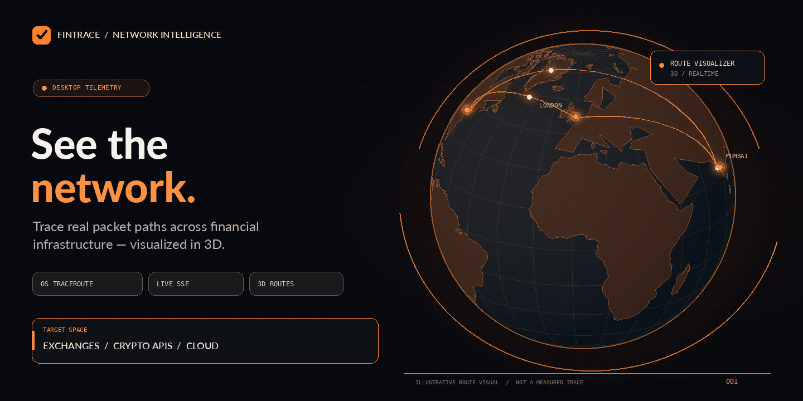
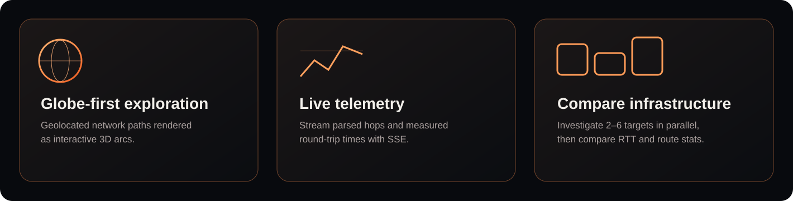
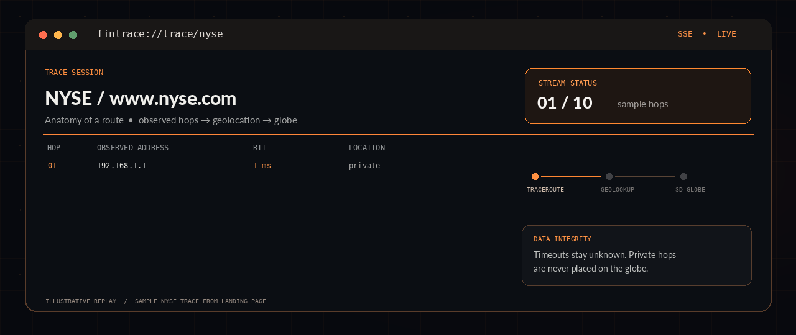
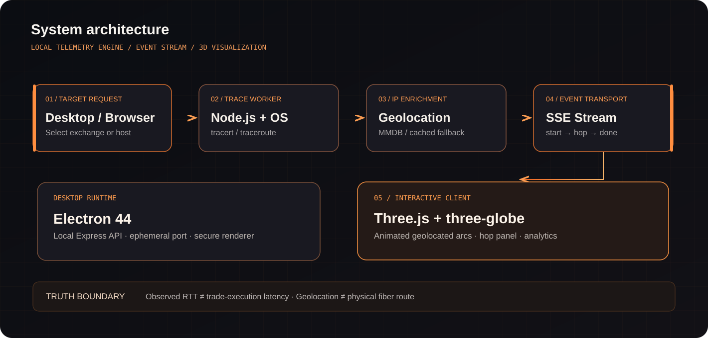

<div align="center">



<br />

[](./electron)
[](./frontend/src/components/globe)
[](./backend/src/sse.js)
[](./backend)

<br />

### **Network telemetry for the infrastructure behind global markets.**

**Trace paths. Observe latency. Explore the network in three dimensions.**

[Architecture](#-architecture) · [Live telemetry](#-from-trace-to-visualization) · [Features](#-capabilities) · [Run locally](#-get-started) · [API](#-api-surface) · [Engineering notes](#-accuracy-privacy--engineering-boundaries)

</div>

---

## The product

**FinTrace** is a desktop-first network observability experience for financial infrastructure. It runs **real operating-system traceroutes** from the machine running its backend, enriches responding public hops with approximate geography, and streams the results to an interactive **Three.js globe** and a terminal-style telemetry interface.

Explore network routes to **stock exchanges, market-data providers, cryptocurrency APIs, and cloud regions**. Compare multiple destinations, examine hop-by-hop round-trip times, and investigate how network observations change during a session.

> **Built for visibility, not fictional precision.** The network measurements come from `tracert` / `traceroute`. The visual arcs connect *geolocated observations*, not actual fiber-optic cable paths. Destination coordinates are approximate landmarks.

<div align="center">

</div>

### At a glance

| **9** curated destinations | **2–6** comparison targets | **30 s** optional repeat interval | **3D** geospatial rendering |
|:--:|:--:|:--:|:--:|
| Exchanges · crypto API · cloud · data | Compare in parallel | Live-mode re-traces | Animated arcs · points · camera controls |

---

## The experience

<div align="center">


<sub>Illustrative replay of the **sample NYSE trace already included in the landing page**. This GIF is not a live traceroute or a screenshot of production measurements.</sub>
</div>

The interface combines a spatial view with the data needed to interpret it: **which hop responded, how long it took, whether it timed out, and whether its IP could be geolocated**.

### Three ways to investigate

| Mode | Experience | What it tells you |
|---|---|---|
| **Single trace** | Pick a curated target or enter a permitted public host | Responding hops, RTT samples and approximate locations |
| **Live mode** | Re-run a trace approximately every 30 seconds | How an observed route and its metrics change over time |
| **Compare mode** | Analyze 2–6 different targets | Relative RTT, per-route status, rankings and sparkline comparisons |

The app includes a **hop table**, animated route segments, destination markers, an analytics panel and time-series history. Unknown or timed-out hops remain unknown; FinTrace does not invent a geographic coordinate for them.

---

## From trace to visualization

```mermaid
%%{init: {'theme': 'dark', 'themeVariables': {'primaryColor':'#201713','primaryTextColor':'#fff3e7','primaryBorderColor':'#ed8e44','lineColor':'#ed8e44','secondaryColor':'#14171e','tertiaryColor':'#14171e'}}}%%
flowchart LR
    A["Choose target"] --> B["Validate public hostname / IP"]
    B --> C["Spawn OS traceroute"]
    C --> D["Parse hop IP + RTT"]
    D --> E["Geolocate public hops"]
    E --> F["Stream SSE events"]
    F --> G["Three.js globe + hop panel"]
    G --> H["Metrics + comparisons"]
```



**Under the hood:**

1. **Target selection** — the frontend loads the curated destination list from `GET /api/endpoints`, or accepts a validated custom public hostname.
2. **Execution** — the Express API starts `tracert -d` on Windows or `traceroute -n` on macOS/Linux as a child process.
3. **Parsing** — each observed hop is converted into a structured object containing hop index, responding IP, RTT and timeout state.
4. **Enrichment** — public IPs are resolved using a local **MMDB** database when present, with a throttled **ip-api.com** fallback where needed. Private/internal addresses are not geolocated.
5. **Streaming** — the server emits `start`, `hop`, and `done` / `error` events via **Server-Sent Events (SSE)**.
6. **Rendering** — the frontend's `GlobeView` draws geolocated points, route arcs and destination rings; analytics compute RTT statistics, hop deltas, timeouts and geographic-span estimates.

A browser alone cannot execute arbitrary OS traceroute commands. **The local Node.js / Electron backend is what makes the measurements real.** The `landing/` marketing site uses explicitly sample data instead.

---

## Architecture

<div align="center">

</div>

| Layer | Implementation | Relevant source |
|---|---|---|
| **Desktop shell** | Electron 44; launches a local Express instance on an available port and loads its served frontend | [`electron/main.js`](./electron/main.js) |
| **Frontend** | Vanilla ES modules, Vite, Three.js, three-globe, OrbitControls | [`frontend/src`](./frontend/src) |
| **API** | Express HTTP endpoints and streamed SSE responses | [`backend/server.js`](./backend/server.js) |
| **Trace engine** | OS subprocess, line parsing, timeout and process cleanup | [`traceRunner.js`](./backend/src/traceRunner.js) |
| **IP enrichment** | MMDB lookup, bounded in-memory cache, throttled remote fallback | [`geolocate.js`](./backend/src/geolocate.js) |
| **Spatial analytics** | Haversine estimates, hop deltas, RTT and timeout summaries | [`geoMath.js`](./frontend/src/lib/geoMath.js) |
| **Marketing site** | Separate static Vite + Three.js landing page with sample telemetry | [`landing/`](./landing) |

<details>
<summary><b>Explore the repository layout</b></summary>

```text
fintrace/
├── backend/
│   ├── server.js                    # REST + SSE API; target validation
│   ├── src/traceRunner.js          # OS traceroute + hop parser
│   ├── src/geolocate.js            # MMDB / ip-api fallback
│   ├── src/endpoints.js            # Curated financial targets
│   └── src/sse.js                  # SSE transport + heartbeat
├── frontend/
│   ├── src/components/globe/      # 3D globe, arcs, controls
│   ├── src/components/compare/    # Multi-target comparison
│   ├── src/components/analytics/  # RTT charts and metrics
│   ├── src/components/panel/      # Hop telemetry display
│   └── src/main.js                # Client orchestration
├── electron/                       # Local backend + desktop window
├── landing/                        # Static product/marketing site
├── test/                           # Node test suites
└── README.md
```

</details>

---

## Capabilities

<table>
<tr><td width="50%" valign="top">

### 01 / Globe-first telemetry

- Real 3D Earth renderer built with Three.js + three-globe
- Orbit camera, auto-rotation, destination markers and animated arcs
- Hop-by-hop route reconstruction **only from available geolocation data**
- Approximate destination landmarks, rather than fake rack-level precision

</td><td width="50%" valign="top">

### 02 / Measured latency

- Real OS traceroute samples, not browser-simulated hops
- Per-hop RTT, timeouts, min/max/mean RTT and hop-to-hop deltas
- Time-series visualizations and latency classifications
- A clear distinction between RTT observations and geographic estimates

</td></tr>
<tr><td width="50%" valign="top">

### 03 / Parallel route comparison

- Compare **2–6** different endpoints in one investigation
- Route identity colors, progress, completion status and RTT ranking
- Sparkline comparisons; failed and timed-out targets remain visible
- At most **six concurrent** trace jobs server-side

</td><td width="50%" valign="top">

### 04 / Local-first desktop workflow

- Electron shell starts the Node backend on localhost
- Windows x64 installer and portable packaging targets in `electron-builder`
- Optional local `.mmdb` IP database to reduce external lookups
- Input validation and trace-process cleanup on disconnect / shutdown

</td></tr>
</table>

---

## Destination coverage

FinTrace ships with **nine selectable targets** in four categories. These are the actual targets configured in [`backend/src/endpoints.js`](./backend/src/endpoints.js).

| Category | Destinations |
|---|---|
| **Exchanges** | NSE India · BSE India · NYSE · Nasdaq |
| **Crypto API** | Binance API |
| **Cloud regions** | AWS `ap-south-1` · AWS `us-east-1` |
| **Market data** | Bloomberg · Reuters |

> A target is a **network hostname**. Its measured RTT may reflect the destination's DNS/CDN/network behavior, filtering, or intermediate routers. It does **not** measure exchange matching-engine latency or guarantee the physical location of the service.

---

## API surface

The local backend listens on `127.0.0.1:3001` by default when run separately. When started by Electron, it uses an automatically selected free local port.

| Method | Route | Behavior |
|---|---|---|
| `GET` | `/api/health` | Backend liveness check |
| `GET` | `/api/endpoints` | Curated target metadata |
| `GET` | `/api/trace/:target` | SSE trace stream: `start`, `hop`, `done` / `error` |

Example, after starting the backend:

```bash
curl -N http://127.0.0.1:3001/api/trace/nyse
```

```text
# Stream structure (illustrative, not a live response)
event: start
data: {"host":"www.nyse.com","label":"NYSE"}

event: hop
data: {"hopIndex":1,"ip":"192.168.1.1","rttMs":1,"timedOut":false,"geo":null}

event: done
data: {}
```

**Guards:** public-host validation (including DNS resolution for hostnames), denial of private/loopback/reserved targets, a maximum of **20 hops**, a **60-second** process deadline, at most **six concurrent** traces, and process cleanup when a trace is stopped. Not all routers respond to traceroute probes.

---

## Get started

**Requirements:** Node.js **20+ recommended** (Node.js 18+ supports the backend's built-in `fetch`), npm, and access to the operating system's `tracert` or `traceroute` executable. Windows uses `tracert -d`; macOS/Linux use `traceroute -n`.

### Option A — Run the web UI and local API

```bash
# 1. Clone the repo
git clone https://github.com/Vedanto28/fintrace.git
cd fintrace

# 2. Install each workspace's dependencies
cd backend && npm ci
cd ../frontend && npm ci
```

**Terminal 1 — backend**

```bash
cd backend
npm start
# http://127.0.0.1:3001
```

**Terminal 2 — frontend**

```bash
cd frontend
npm run dev
# http://localhost:5173
```

Vite proxies `/api` to the local Express backend; no external hosted API is required.

### Option B — Launch the desktop application

From the repository root, after installing backend and frontend dependencies:

```bash
npm ci
npm run electron:dev
```

The desktop process starts the local API, waits for `/api/health`, and opens its application window. For Windows packaging, the repository defines:

```bash
npm run package       # Windows installer + portable targets
```

Packaging is defined for **Windows x64**. Other operating systems can run the web version where the required traceroute executable is available; installers for those platforms are not configured in the repository.

### Option C — Explore only the static landing page

```bash
cd landing
npm ci
npm run dev
# http://localhost:5174
```

This landing experience includes a real WebGL renderer but **sample trace data**. To perform an actual live trace, run the application with its backend.

---

## Testing

From the repository root:

```bash
npm test
```

The Node test suites cover trace parsing, target validation, process/server lifecycle, geolocation, great-circle calculations and compare-mode logic. The README does not hardcode a passing-test count: use the test runner and CI results for the current commit.

---

## Accuracy, privacy & engineering boundaries

| What FinTrace shows | What the data actually means |
|---|---|
| **RTT (ms)** | Observed round-trip timing reported by the underlying traceroute tool; not exchange execution time |
| **3D arcs** | Visualization connecting **geolocated responding hops**; not confirmed physical cable routes |
| **Destination pins** | Approximate geographic landmarks, not verified hardware/server locations |
| **Unknown hops** | Timeout/unlocated nodes remain missing, not interpolated into fabricated coordinates |
| **Geolocation** | Local MMDB when configured; otherwise a cached, rate-limited `ip-api.com` fallback |
| **Web3-inspired visual design** | A visual aesthetic only; **no blockchain, wallet, token, or on-chain infrastructure is claimed** |

### Optional offline IP geolocation

FinTrace supports MaxMind-compatible `.mmdb` databases. Supply `FINTRACE_MMDB_PATH` or place a supported DB-IP Lite / GeoLite2 file in `backend/data/`. See [`backend/data/README.md`](./backend/data/README.md) for placement and licensing guidance.

If a public hop is not resolved locally and `offlineOnly` is not selected, the code may query **ip-api.com via HTTP**, sharing that public hop IP with the external provider. A local database reduces this dependency; it does not make network traceroute itself an offline operation.

**Attribution:** [DB-IP](https://db-ip.com) geo data is distributed subject to its applicable license, including CC BY 4.0 for DB-IP Lite.

---

## Where the project is going

The underlying renderer, traceroute execution, SSE transport and desktop shell are implemented. These are **future opportunities**, not shipped claims:

- [ ] Route-history persistence and exportable investigation sessions
- [ ] Configurable latency-change alerts and reproducible baselines
- [ ] Automated regression checks against long-running network observations
- [ ] Additional desktop build targets and signed distribution
- [ ] More granular data-provider provenance and privacy controls

---

<div align="center">

**FINTRACE** · *An observability lens on the networks that connect global markets.*

<sub>Open-source engineering showcase · Network telemetry · Three-dimensional geospatial UX</sub>

<br /><br />

[](https://github.com/Vedanto28/fintrace)
[](https://github.com/Vedanto28/fintrace/releases)

</div>
